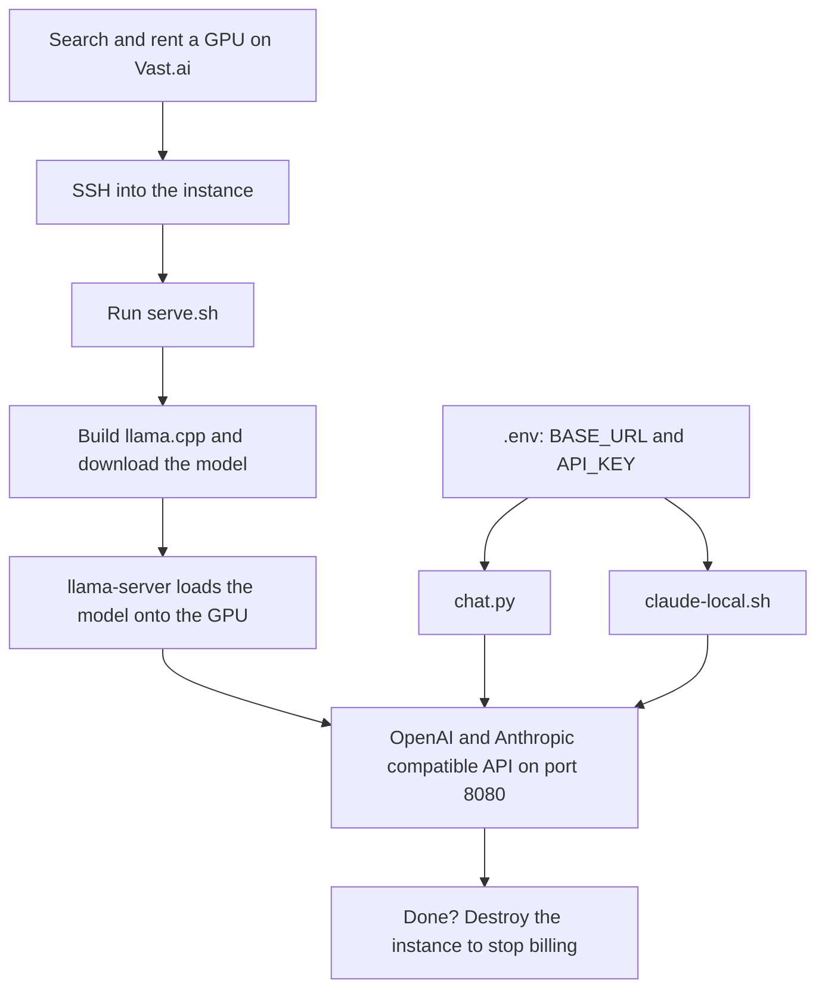

# cloud-gpu-llm

Run any local model on a rented GPU.

Big open-weight models (70B and up) don't fit on a laptop. This repo is a small set of scripts for renting a GPU by the hour on [Vast.ai](https://vast.ai), loading a model onto it with [llama.cpp](https://github.com/ggml-org/llama.cpp), and talking to it from your own machine, either from a terminal chat client or as the backend for [Claude Code](https://claude.com/claude-code). You pay only while the instance exists, typically $1 to $4 per hour.

The defaults run an abliterated Llama 3.3 70B (a community fine-tune with refusal behavior removed), but `serve.sh` takes any single-file GGUF from Hugging Face.

## How it works



1. **Rent.** You pick a GPU offer with the `vastai` CLI. Vast starts a container from a CUDA image, with SSH and port 8080 exposed.
2. **Serve.** `serve.sh` runs inside that container. It compiles llama.cpp with CUDA, downloads the GGUF model from Hugging Face, and starts `llama-server`.
3. **Connect.** `llama-server` speaks both the OpenAI chat API and the Anthropic Messages API, so the same endpoint works for `chat.py` and for Claude Code. Your laptop only sends text and receives tokens; all the compute happens on the rented GPU.
4. **Stop.** Destroying the instance ends the billing.

## What's in the repo

| File | Runs on | What it does |
|---|---|---|
| `serve.sh` | The rented GPU | Builds llama.cpp, downloads the model, serves the API on port 8080 |
| `chat.py` | Your machine | Minimal streaming terminal chat client for the OpenAI-style endpoint |
| `claude-local.sh` | Your machine | Starts Claude Code with its API pointed at your instance |
| `.env.example` | n/a | Template for the `.env` file that the two clients read |

## Requirements

- A Vast.ai account with credit, and an API key with Instances read/write permission
- The Vast CLI: `pip install vastai`, then `vastai set api-key <key>`
- An SSH key registered with Vast: `vastai create ssh-key "$(cat ~/.ssh/id_ed25519.pub)"`
- Python 3 for `chat.py`, and Claude Code if you want to use `claude-local.sh`

## Step by step

**1. Find a GPU.** This lists verified single-GPU 80GB A100s with enough disk and a fast connection, cheapest first:

```
vastai search offers 'gpu_name=A100_SXM4 num_gpus=1 gpu_ram>=80 verified=true disk_space>=100 inet_down>=500 reliability>0.98' -o 'dph+'
```

**2. Rent it.** Billing starts as soon as this succeeds:

```
vastai create instance <offer_id> \
  --image pytorch/pytorch:2.5.1-cuda12.4-cudnn9-devel \
  --disk 150 --ssh --direct --env '-p 8080:8080'
```

Then run `vastai show instance <id> --raw` to get the instance's public IP, its SSH port, and the public port that maps to 8080.

**3. Start the server.** Copy `serve.sh` to the instance and run it in the background. The first run compiles llama.cpp (around 15 minutes) and downloads the model; later runs skip both.

```
scp -P <ssh_port> serve.sh root@<ip>:/workspace/
ssh -p <ssh_port> root@<ip>
cd /workspace && API_KEY=$(openssl rand -hex 16) nohup ./serve.sh > serve.log 2>&1 &
```

Keep that API key. Watch `serve.log` until it prints `listening on http://0.0.0.0:8080`.

**4. Configure the clients.** Copy `.env.example` to `.env` and fill it in:

```
BASE_URL=http://<ip>:<mapped_port>/v1
API_KEY=<the key you used in step 3>
```

**5. Use it.**

```
set -a; source .env; set +a
python3 chat.py          # terminal chat
./claude-local.sh        # Claude Code backed by your model
```

**6. Shut it down.**

```
vastai destroy instance <id>
```

## Configuration

`serve.sh` reads these environment variables:

| Variable | Default | Meaning |
|---|---|---|
| `API_KEY` | required | Bearer token the server requires |
| `MODEL_REPO` | `bartowski/Llama-3.3-70B-Instruct-abliterated-GGUF` | Hugging Face repo to download from |
| `QUANT_FILE` | `Llama-3.3-70B-Instruct-abliterated-Q4_K_M.gguf` | Single GGUF file in that repo |
| `CTX` | `65536` | Total context in tokens, split across slots |

To run a different model, set `MODEL_REPO` and `QUANT_FILE`. Only single-file GGUFs are supported; quants that Hugging Face splits into several parts (such as 8-bit 70B) are not handled yet.

### Picking a GPU for a model

Rule of thumb for 4-bit quants: the file size plus about 20GB of room for the context cache must fit in VRAM.

| Model size | VRAM needed | Rental |
|---|---|---|
| About 70B | About 60GB | 1x A100 or H100, 80GB |
| About 235B mixture-of-experts | About 150GB | 2x H100 |
| 600B and up | 350GB or more | 8x H100 |

The 70B setup here uses about 61GB with a 64k context, and produces about 23 tokens per second, with prompt processing at roughly 500 to 650 tokens per second on an A100.

## Using Claude Code with it

`claude-local.sh` sets `ANTHROPIC_BASE_URL` to your instance and passes the server key as the auth token. It also changes some things on purpose, because a self-hosted 70B behaves differently from Claude:

- **Default permission mode.** Every command asks for approval. Keep this on: an abliterated model has no refusal training and will act on whatever it is given.
- **No Agent tool.** The model spawns subagents for trivial requests, and each one sends its own full prompt, which swamps a single GPU.
- **No MCP servers.** `--strict-mcp-config` skips the ones in your Claude Code settings. Their tool descriptions add thousands of tokens to every request and confuse a smaller model.
- **Thinking off.** `MAX_THINKING_TOKENS=0` stops short questions from turning into hundreds of tokens of reasoning.

On the server side, two settings matter for speed. Claude Code's prompt is around 12,000 to 15,000 tokens, so `serve.sh` runs with a 64k context and `--cache-reuse` so that follow-up messages reuse the cached prompt instead of reprocessing it. It runs 2 slots (`-np 2`), which means each slot gets half the context (32k) but Claude Code's background requests no longer evict your main conversation's cache. Claude Code's status bar still shows a 200k window, so run `/compact` before a session nears 32k tokens.

Expect rough edges. Llama 3.3 70B is a much weaker agent than Claude, and it sometimes picks odd tools or asks needless questions.

## Cost

You are billed per hour while the instance exists. An A100 80GB was about $1.15 to $1.20 per hour at the time of writing, and prices vary by host. A stopped instance does not bill for the GPU but still bills for its disk, so run `vastai destroy instance <id>` when you are finished. That also deletes the downloaded model and the llama.cpp build, so the next run starts from scratch.

## Safety

- Abliterated models have their refusal behavior removed. Keep permission prompts on when using one with Claude Code.
- The endpoint is plain HTTP on a public IP, protected only by the API key. Don't send secrets, credentials, or private code through it.
- Keep `.env` out of version control. It is in `.gitignore`.
- Use a Vast API key limited to Instances and User read, not billing, and revoke it when you are done.

## Troubleshooting

- **Out of memory when restarting the server.** The old `llama-server` hadn't released the GPU yet. Wait until `nvidia-smi` shows near 0 MiB used, then start again.
- **Killing the server over SSH.** Use `pkill -f '[b]uild/bin/llama-server'`. The brackets stop the pattern from matching the shell running the command, which would otherwise kill your own SSH session.
- **Connection refused after a restart.** The public port can change when an instance is recreated. Re-read it with `vastai show instance <id> --raw` and update `.env`.
- **Slow first reply.** The first message has to process the whole prompt. Later messages reuse the cache and are much faster.
